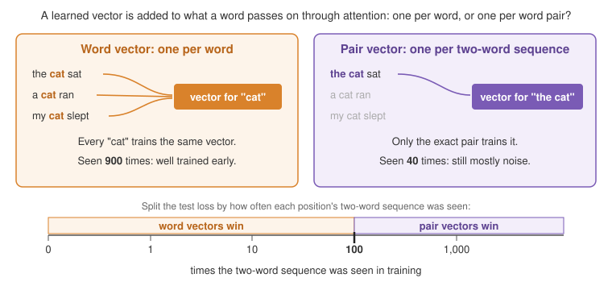
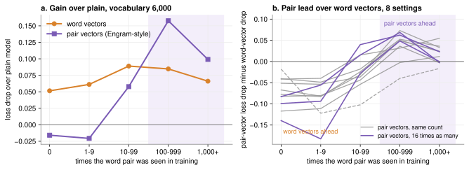
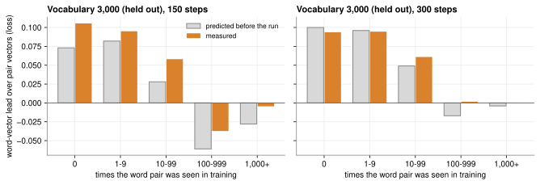
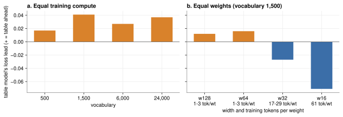
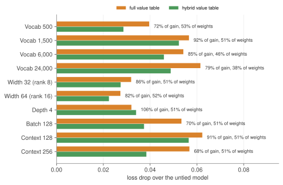
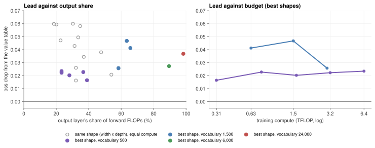
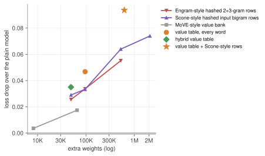
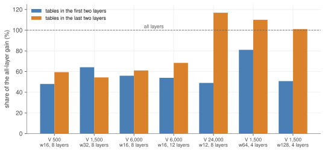

# Value Embeddings: Inside a Language Model's Attention, One Learned Vector per Word Beats One per Two-Word Sequence Until the Sequence Has Been Seen About 100 Times in Training

<p style="border:1px solid #c9c9c9;background:#f6f6f6;padding:10px 14px;margin:14px 0 22px;font-size:15px"><b>AI conference paper setup by Vuk Rosić.</b> The idea is judged to be novel, and with further work it may be submitted to a top AI conference.<br><b>In one sentence:</b> a language model can store a learned vector for each word, or for each two-word sequence, and add it inside its last attention layers; the vector for each word works better until the two-word sequence has been seen about 100 times in training, because it is trained every time the word appears, and this one rule explains why published papers found per-word vectors ahead, tied or behind.</p>

Vuk Rosić · [AI Research School](https://www.skool.com/become-ai-researcher-2669) · November 2026 · draft for ICML 2027

## Abstract

A language model can store a learned vector for each word (a word vector) and add it to that word's attention value in the last layers; this is a value embedding. It can instead store one vector for each two-word sequence (a pair vector), as Engram does. Published comparisons disagree: word vectors win in some papers, the two tie in another, and pair vectors win after long training. One rule explains all three. A word vector is trained every time its word appears; a pair vector only when its exact sequence appears. So word vectors win on positions whose sequence was seen fewer than about 100 times in training, and pair vectors win after. We show this by splitting the test loss by how often each position's sequence was seen. Fitted on two vocabularies, the rule predicted which kind wins at each frequency on a held-out vocabulary size, with the overall gap right in the longer run and too small in the shorter one. Against models without them, word vectors win at equal compute but not at equal parameter count.

### In simple words

Think of a student who keeps a notebook. One notebook has a page per word: every time "cat" appears, the student adds to the "cat" page. Another notebook has a page per word pair: the "the cat" page grows only when exactly "the cat" appears, while "a cat" and "my cat" go to other pages. After a short course, the word pages are full and most pair pages are nearly empty. Language models behave the same way: the pair page starts to beat the word page only once the pair has been seen about 100 times.



*Figure 1. A word vector is trained by every appearance of its word; a pair vector only by its exact pair. Word vectors win on pairs seen fewer than about 100 times, pair vectors after.*

## 1. Introduction

**The finding.** When a language model adds a learned vector to the attention value in its last layers, a vector stored for each word beats a vector stored for each two-word sequence on every position whose sequence has been seen fewer than about 100 times in training, and the pair vector wins after that, provided the pair table has enough vectors.

**What is known.** A *lookup table* stores one learned vector per key. The model finds the vector by the key's ID, like finding a page by its number. Attention lets each word read from earlier words, and each earlier word offers a vector called its *value*. In "the cat sat", when "sat" looks back at "cat", it reads the value of "cat". A *value embedding* adds a learned vector for the word "cat" to that value.

Both keys are published. Word vectors appear in speedrun training code, in Bank of Values (He et al. 2026), which helps models of 135M and 780M weights, and in X-GRAM (Chen et al. 2026). STEM (Sadhukhan et al. 2026) puts per-token vectors in the feed-forward block instead. Pair vectors appear in Engram (Cheng et al. 2026), which stores hashed vectors for 2-word and 3-word sequences, in the modded-nanogpt bigram-hash record (PR #201), and in the n-gram input tables of Over-Tokenized Transformers (Huang et al. 2025).

The comparison is published too, and the results point in different directions:

- X-GRAM finds that a single-token table added to the attention value beats Engram at comparable table sizes.
- Hash Layers (Roller et al. 2021) finds that routing by the current token beats routing by a hash of the last two tokens.
- Over-Tokenized Transformers finds a 2-gram-only input table worse than a 1-gram one.
- MoME (Li et al. 2026) finds a value embedding and a bigram table tied at 135M weights.
- LongCat (Liu et al. 2026) finds that after 300B tokens, n-gram tables beat per-layer per-token vectors.

X-GRAM also names the cause of weak large tables: under Zipf's law most vectors are rarely updated, and it gives frequent tokens their own vectors.

**What is not known.** No paper gives the count at which a pair key overtakes a word key, so none can say before a run which key will win, or why the published results disagree. We measure that count by splitting the test loss by how often each position's pair was seen in training, and test it as a prediction on a vocabulary we held out.

**How we test it.** We use small models, where hundreds of runs fit on a laptop, and move one large-model condition at a time: vocabulary from 500 to 24,000 words, depth from 2 to 12, width from 8 to 128, and training length. Word and pair tables get the same number of vectors, in the same layers, with their learning rates tuned. We rebuilt Engram's full design.

The finding rests on three claims:

1. **The crossover.** Split by pair sightings, word vectors beat pair vectors on positions whose pair was seen fewer than about 100 times, and pair vectors win from there, in every setting with enough pair vectors (Section 4).
2. **A prediction.** The rule, fitted at vocabularies 1,500 and 6,000, predicted which table wins in each sighting range at held-out vocabulary 3,000 before it was run. The overall gap was right at 300 steps and 0.024 too low at 150 steps (Section 5).
3. **Two budgets.** At equal training compute, a word table reaches lower loss than every plain model size. At equal weights, a wider plain model wins once training passes about 17 tokens per weight (Section 6).

Section 7 shows that the rule explains X-GRAM's frequency split, MoME's tie and LongCat's long-run reversal. Several results in our runs are already published: word vectors beating Engram with the same number of vectors (X-GRAM), single-word keys beating pair keys (Hash Layers, Over-Tokenized), rarely trained vectors being undertrained and a table split by frequency (X-GRAM), and value tables in late layers (Bank of Values). We report them as consistent with the rule, not as findings.

## 2. Method

**Word vectors.** In each chosen layer, the value of word `w` becomes:

```python
v = W_V @ h + lam * T[w]          # T: one learned vector per word (V x d), lam: a learned number
```

Here `h` is the word's hidden vector, `W_V @ h` is the usual value, and `V` and `d` are the vocabulary size and the model width. The lookup does no multiplications, so the table adds memory, not compute.

**Pair vectors.** We test three pair tables with the same number of vectors (V per table):

- *Hashed pair value vectors*: the same formula, with `T` indexed by a hash of (previous word, current word). *Hashing* maps each pair to one of V vectors, so unrelated pairs can share a vector.
- *Engram-style core*: hashed vectors for 2-word and 3-word sequences, gated and added to the hidden vector before the first of the two table layers.
- *Engram full design*: the core plus 4 hash functions per sequence length, key and value maps, a learned gate and a short convolution, rebuilt from the Engram paper.

**Sighting buckets.** For every test position we count how often its pair (previous word, current word) appeared in the training text. In "the cat sat", the position of "cat" has the pair ("the", "cat"). If that pair appeared 40 times in training, the position falls in the 10-99 bucket. The buckets are 0, 1-9, 10-99, 100-999 and 1,000+, and we report the loss in each. The share of positions in each bucket depends only on the data, so we compute it without training (`pairstat.py`, `pw.py --pcshare 1`).

## 3. Setup

**Model.** A standard small transformer: RMSNorm, rotary positions (RoPE), QK-norm, a SwiGLU feed-forward block and no biases. The input and output tables are separate. Width is 16 by default (8 to 160 in sweeps). Depth is 2 layers by default (up to 12). The largest model has 2.2M weights.

**Training.** Muon trains the layer matrices at rate 0.02. Adam trains the embeddings, norms and tables. The text is FineWeb in GPT-2 tokens, and each token is read once. A *vocabulary* of V words is the V-1 most common GPT-2 tokens plus one *unknown* token for everything else. Context is 64 tokens; batch is 32 to 256 sequences; runs last 100 to 1,600 steps.

**Score.** The *loss* measures how surprised the model is by the true next word; lower is better. A drop of 0.03 is a clear gain at this scale. We score only known next words on 1,000 held-out sequences, because the unknown token exists only in small vocabularies.

**Compute.** We count the FLOPs of every matrix, attention and table per token. Training compute is 3 × forward FLOPs × tokens.

**Runs.** 872 runs, mostly 3 to 40 seconds each on a laptop. One run per setting, so gaps under about 0.01-0.02 are treated as ties.

## 4. Claim 1: word vectors win until the two-word sequence has been seen about 100 times in training

**Why.** A vector is trained only when its key appears. The word "cat" appears in "the cat", "a cat" and "my cat", so its vector gets every one of those updates. The vector for ("the", "cat") gets only the first kind. A vector trained a handful of times is mostly noise, so it can even hurt. Once a pair has been seen often, its vector can store what follows that exact pair, which a word vector cannot. So the pair vector should lose on rare pairs and win on common ones.

**Test.** Plain model, word vectors and pair vectors, with the same number of extra vectors in the same layers, each at its best learning rate. We split the test loss by sighting bucket in 8 settings: vocabularies 500, 1,500, 6,000 and 24,000; depths 2 and 8; two training lengths. We add the same comparison with 16 times the pair vectors.

**Result.** Panel (a) of Figure 2 shows one setting. Word vectors help in every bucket. Pair vectors hurt on pairs seen fewer than 10 times and help most on pairs seen 100-999 times, where they gain 0.158 against 0.085 for word vectors.



*Figure 2. (a) At vocabulary 6,000, pair vectors (purple) pass word vectors (orange) only on pairs seen 100+ times (shaded). (b) The same crossover in 8 settings: below the line, word vectors lead. The dashed line is vocabulary 500, where pair vectors never pass with this many vectors; with 16 times the vectors (purple lines) they pass.*

The word-vector lead in each bucket (pair-vector loss minus word-vector loss; positive means word vectors win):

| Setting | 0 | 1-9 | 10-99 | 100-999 | 1,000+ |
|---|---|---|---|---|---|
| Vocabulary 1,500, depth 2, 150 steps | +0.078 | +0.083 | +0.024 | **−0.050** | −0.023 |
| Vocabulary 1,500, depth 8, 150 steps | +0.051 | +0.054 | +0.037 | **−0.050** | −0.024 |
| Vocabulary 6,000, depth 2, 150 steps | +0.067 | +0.082 | +0.031 | **−0.073** | −0.033 |
| Vocabulary 6,000, depth 8, 150 steps | +0.041 | +0.049 | +0.018 | **−0.052** | −0.036 |
| Vocabulary 1,500, depth 2, 300 steps | +0.117 | +0.111 | +0.054 | +0.003 | −0.012 |
| Vocabulary 6,000, depth 2, 300 steps | +0.082 | +0.080 | +0.044 | **−0.036** | +0.003 |
| Vocabulary 24,000, depth 2, Engram full | +0.042 | +0.040 | −0.015 | **−0.032** | −0.055 |
| Vocabulary 500, depth 2, 300 steps | +0.018 | +0.122 | +0.102 | +0.040 | +0.016 |
| Three 300-step settings, 16 times the pair vectors | +0.08 to +0.14 | +0.06 to +0.18 | −0.04 to +0.03 | **−0.05 to −0.07** | −0.02 to 0.00 |

Word vectors lead on pairs seen fewer than 10 times in all 11 settings. Pair vectors lead on pairs seen 100-999 times in 9 of 11. The 10-99 bucket is the transition: word vectors lead there in 8 of 11. The two exceptions point the same way. At vocabulary 1,500 and 300 steps the 100-999 bucket is a tie. At vocabulary 500, 500 vectors are shared by 67,000 different pairs, and pair vectors never pass word vectors; with 16 times the vectors they do. So the 100-sighting line holds when each pair has enough of its own vector.

**Which table wins overall** depends on how much text sits below the line. At vocabulary 6,000, 60-66% of test positions have pairs seen fewer than 100 times, and word vectors win overall by 0.020-0.030. At vocabulary 24,000 the share is 82%. At vocabulary 1,500 it is only 33-42%, and after 150 steps the two tables tie overall (0.001).

**Overall loss, consistent with X-GRAM.** X-GRAM reports that single-token value vectors beat Engram at comparable table sizes in models of 0.73B and 1.15B weights. Our runs with the same number of vectors agree, with Engram's full design included, and the buckets say why: in these runs most positions sit below 100 sightings. Each arm is at its best learning rates:

| Setting | Plain | Engram, core | Engram, full | Word vectors | Word lead |
|---|---|---|---|---|---|
| Vocabulary 500, depth 4 | 4.4617 | 4.4286 | 4.4227 | **4.4099** | 0.013 |
| Vocabulary 1,500, depth 4 | 5.0025 | 4.9732 | 4.9669 | **4.9607** | 0.006 (tie) |
| Vocabulary 6,000, depth 2 | 5.7460 | 5.7041 | 5.6925 | **5.6819** | 0.011 |
| Vocabulary 24,000, width 16 | 6.4127 | 6.3837 | 6.3844 | **6.3710** | 0.013 |

The tie is at vocabulary 1,500, the setting with the fewest positions below the line. In an 8-layer model the pattern repeats in the last two layers, and the word lead grows with vocabulary, as the rule predicts when more positions are rare. Gains over plain, best of 2-3 rates each:

| Setting | Word vectors | Hashed pair value vectors | Engram-style vectors |
|---|---|---|---|
| Vocabulary 1,500, width 32 | **0.033** | 0.029 | 0.016 |
| Vocabulary 6,000, width 16 | **0.053** | 0.032 | 0.023 |
| Vocabulary 24,000, width 12 | **0.072** | −0.010 | 0.001 |

At vocabulary 24,000 the run is short (0.7 tokens per weight), so few pairs reach 100 sightings and pair vectors gain nothing.

**Where pair vectors catch up.**

- *More vectors and longer training.* With 16 times the vectors and 2-4 times the tokens, Engram-style tables gain 0.066, 0.059 and 0.058 at vocabularies 500, 1,500 and 6,000. Word vectors gain 0.062, 0.038 and 0.061.
- *Narrow models.* At vocabulary 6,000 the word lead is 0.008, 0.000, 0.022 and 0.020 at widths 8, 12, 16 and 24. At vocabulary 24,000 and width 12, Engram leads by 0.012. A word vector of 8-12 numbers holds too little to help much on common words.
- *Large data.* Counting pairs, with no training, the share of positions whose pair was seen 100+ times is 0.34 at vocabulary 6,000 after 1.2M tokens and 0.76 after 50M. At GPT-2's vocabulary after 50M tokens it is 0.49.

**Single-word keys.** Vectors keyed by the previous word alone work as well as vectors keyed by the current word (0.082 against 0.070 at vocabulary 6,000, depth 2). Fewer pair vectors do not help: at vocabulary 6,000, depth 8, 375 or 1,500 pair vectors give 5.5774 and 5.5776, against 5.5653 with 6,000 vectors and 5.5442 for word vectors. Both fit the rule (Section 7).

## 5. Claim 2: the rule predicts a held-out vocabulary size

**Why.** If the overall gap is set by the sighting buckets, it equals the sum over buckets of (share of positions in the bucket) × (word lead in that bucket). The shares come from the data alone. The word lead per bucket can be carried over from nearby settings. A rule that only describes past runs could not do this.

**Test.** We held out vocabulary 3,000 and wrote the prediction in `RESULTS.md` before any run there.

- *Check on known settings.* The bucket sum reproduces the measured gaps at vocabularies 1,500 and 6,000: 0.0011 against 0.0008 and 0.0214 against 0.0199 at 150 steps, and 0.0213 against 0.0200 and 0.0320 against 0.0301 at 300 steps.
- *Per-bucket lead at 3,000.* The mean of the 1,500 and 6,000 values, since 3,000 is their midpoint on a log scale.
- *Shares at 3,000.* Counted from the data, with no training.
- *What would break the rule.* Pair vectors ahead on any bucket under 100 sightings; word vectors ahead on the 100-999 bucket at 150 steps; or an overall gap more than 0.015 from the prediction.

Then we trained plain, word-vector and Engram-style models at vocabulary 3,000, depth 2, for 150 and 300 steps.

**Result.** No break condition was met. The overall gap was right at 300 steps (0.028 predicted, 0.035 measured) and 0.024 too low at 150 steps (0.011 predicted, 0.035 measured).

| Steps | Plain | Word vectors | Engram-style | Gap predicted | Gap measured |
|---|---|---|---|---|---|
| 150 | 5.3773 | **5.3365** | 5.3716 | 0.011 | 0.035 |
| 300 | 5.1972 | **5.1581** | 5.1927 | 0.028 | 0.035 |



*Figure 3. At the held-out vocabulary, word vectors lead below 100 sightings as predicted (grey: prediction, orange: measured), and pair vectors lead or tie from 100.*

Word vectors led on all three buckets under 100 sightings, by 0.058-0.105. Pair vectors led at 100-999 by 0.037 at 150 steps. At 300 steps the two buckets above 100 tied (+0.002 and 0.000), where the prediction was a small pair lead (−0.017 and −0.004). The 150-step miss has a clear source: at vocabulary 3,000, Engram lost more on rare pairs than at either 1,500 or 6,000, so the average of the two underestimated the per-bucket lead. With the measured per-bucket leads, the bucket sum gives the measured gap (0.035 against 0.035, and 0.036 against 0.035). So the split into shares and per-bucket leads holds; the size of each bucket's lead carries over across vocabularies only roughly.

**Where it is weaker.** The prediction was tested at one held-out vocabulary. A held-out training length past 300 steps would take over 40 seconds per run and was not run.

## 6. Claim 3: word vectors win at equal compute, a wider model without them wins at equal parameter count

**Why.** A lookup adds weights at almost no compute, so two comparisons are fair, and they can disagree. At equal compute, the plain model may grow wider or deeper but must then train for fewer steps. At equal weights, the plain model is widened until it has as many weights as the table model, and it then costs more compute per token. A stored vector works only when its word appears, while a body weight works at every position. So the table should do worse per weight than per unit of compute.

**Test.** *Equal compute*: at each vocabulary, one training budget; plain models of widths 12-32 and depths 2 and 4; table models of widths 12-28; each trains for as many steps as the budget allows. *Equal weights*: at vocabulary 1,500, the table model against plain models widened to the same weight count, for the same tokens, at four widths and training lengths.

**Result.** At equal compute, the best table model reaches lower loss than the best plain model of any shape at all four vocabularies. At equal weights, the table wins only in short training (1-3 tokens per weight); from about 17 tokens per weight, the wider plain model wins.



*Figure 4. (a) At equal training compute the table model leads at every vocabulary. (b) At equal weights it leads only in short training; past about 17 tokens per weight a wider plain model leads (blue).*

| Equal compute | Best plain | Best with table | Table lead |
|---|---|---|---|
| Vocabulary 500 (0.31 TFLOP) | 4.2138 (width 28) | 4.1973 (width 24) | 0.017 |
| Vocabulary 1,500 (0.63 TFLOP) | 4.7544 (width 28) | 4.7131 (width 16) | 0.041 |
| Vocabulary 6,000 (1.53 TFLOP) | 5.5084 (width 24) | 5.4810 (width 24) | 0.027 |
| Vocabulary 24,000 (1.93 TFLOP) | 6.4736 (width 12) | 6.4367 (width 12) | 0.037 |

| Equal weights (vocabulary 1,500) | Tokens per weight | Table model | Plain at the same weights | Table lead | Plain FLOPs per token |
|---|---|---|---|---|---|
| Width 128, depth 4 | 1-3 | 4.6751 | 4.6873 (width 152) | +0.012 | 1.36 × |
| Width 64, depth 4 | 1-3 | 4.6557 | 4.6716 (width 80) | +0.016 | 1.44 × |
| Width 32, depth 4 | 17-29 | 4.5674 | 4.540 (between widths 40 and 48) | −0.027 | 1.8 × |
| Width 16, depth 2 | 61 | gain 0.057 | gain 0.128 (width 28) | −0.071 | 2.0 × |

So each wins in its own budget. A lab limited by training compute gets lower loss from the table. A lab limited by weights, training long, gets lower loss from a wider body. The table's case rests on its compute being almost free: the equal-weight plain models cost 1.4-2 times its FLOPs per token.

**Is the equal-compute lead only the output layer's cost?** In small models the output layer takes most of the compute, so growing the model is costly. If that were the reason, the gain would shrink as the output layer's share falls. Across 12 shapes up to width 128 and depth 8 at vocabulary 1,500, the gain stays at 0.035-0.060 while the output share falls to 19-37% (Appendix B).

**Controls.**

| Control | Result | What it shows |
|---|---|---|
| Vectors frozen at random values | gain −0.003, against 0.057 when learned | The vectors must learn; extra numbers alone do nothing |
| Vectors switched off after training (vocabulary 6,000) | loss rises from 5.7154 to 5.8051, worse than plain (5.7849) | The model relies on the vectors |
| Vectors for 381 random words instead of the 381 most frequent | gain 0.008, against 0.025 | Vectors for frequent words carry the gain |

**Where it is weaker.** At vocabulary 500 the equal-compute lead is 0.017, close to run noise. The equal-weight runs are at one vocabulary.

## 7. What the rule explains in published work

The rule turns the published comparisons from a disagreement into three points on one curve: the share of text whose pairs are seen 100+ times. We did not compute that share for the published training data, so these are consistency checks, not tests.

**X-GRAM's frequency split.** X-GRAM's Appendix C.3 explains why a large table helps little: only 7.3% of entries in a 2M-entry table receive more than 100 updates. It then gives frequent tokens their own vectors and compresses the rest. The rule names the same count: a vector needs about 100 updates before it beats a vector it shares with other keys. Our hybrid table (Appendix A) makes the same split inside a word table; it is close to X-GRAM's design and is not a new contribution.

**MoME's tie.** The rule predicts a tie whenever the positions below and above the line balance, because the word lead below the line and the pair lead above it then cancel. Our vocabulary 1,500 after 150 steps is such a case: 33-42% of positions sit below 100 sightings, and the two tables tie overall (0.001). MoME's tie between a value embedding and a bigram table at 135M weights fits this middle range.

**LongCat's reversal.** After 300B tokens, almost every common pair has been seen far more than 100 times. In our pair counts the share of positions above the line rises with data: from 0.34 to 0.76 at vocabulary 6,000 between 1.2M and 50M tokens, and 0.49 at GPT-2's vocabulary after 50M. The rule therefore predicts that pair tables win in very long runs, which is what LongCat finds against per-layer per-token vectors.

**Single-token keys in short runs.** Hash Layers and Over-Tokenized Transformers find single-token keys ahead of pair keys. Both fit the left side of the curve, where most pairs are rare.

**Placement.** Bank of Values puts its table in the last third of the layers. Our placement runs agree: in 7 settings, tables in the last two layers keep a median 68% of the all-layer gain at 17-50% of the table weights (Appendix F).

## 8. Limits

- Every model has at most 2.2M weights, 2-12 layers and width 8-160.
- The rule says pair tables take over once most pairs pass 100 sightings. Our runs at large vocabularies stop well before that. At GPT-2's vocabulary after 50M tokens, half of positions already pass it.
- The 100-sighting line needs enough pair vectors. With 500 vectors for 67,000 pairs it was not reached.
- The held-out prediction met every break test, but got the overall size right at one of two training lengths, and at 300 steps the buckets above 100 tied instead of showing a small pair lead.
- Section 7 matches published results to the rule without their bucket shares, so it shows consistency, not a test.
- Below width 16, pair vectors tie or win. This was measured at depth 2.
- Engram's full design was rebuilt from its paper, not run from its code.
- One run per setting, so gaps under about 0.01-0.02 are not ordered.

## 9. Related work

**Word tables.** Value embeddings come from speedrun training code. Bank of Values (He et al. 2026) replaces late-layer values with a per-token table and gains at 135M and 780M weights. X-GRAM (Chen et al. 2026) adds frequency-aware token tables to the attention value stream and the residual, beats Engram at comparable table sizes, and explains weak large tables by the under-training of rare vectors. STEM (Sadhukhan et al. 2026) replaces the feed-forward up-projection with a per-token table. MoME (Li et al. 2026) gives each token several vectors and picks among them by context; its value-embedding and bigram baselines tie at 135M weights.

**Pair tables.** Engram (Cheng et al. 2026) adds hashed, gated vectors for 2- and 3-word sequences. The modded-nanogpt bigram-hash record (PR #201) adds a hashed bigram input table to a speedrun. Over-Tokenized Transformers (Huang et al. 2025) scale n-gram input tables and find 2-gram-only tables worse than 1-gram ones. Scone (Yu et al. 2025) adds n-gram input vectors. LongCat (Liu et al. 2026) scales n-gram embedding tables to over 30B weights and finds them ahead of per-layer per-token vectors after 300B tokens. Hash Layers (Roller et al. 2021) routes feed-forward experts by the current token and finds that ahead of routing by a bigram hash.

**Other value-path memory.** MoVE (Li 2026) gates a shared bank of value vectors into the value; Memory Attention (Kang 2026) builds values from a per-token memory; Value Residual Learning (Zhou et al. 2024) adds first-layer values to later ones. Adaptive input representations (Baevski & Auli 2019) give rare words narrower input vectors.

## References

- Baevski, A. & Auli, M. (2019). Adaptive Input Representations for Neural Language Modeling. ICLR.
- Chen, Y., Xie, Y., Gao, Z., Xin, H. et al. (2026). Beyond N-gram: Data-Aware X-GRAM Extraction for Efficient Embedding Parameter Scaling. arXiv:2604.21724.
- Cheng et al. (2026). Engram: Conditional Memory via Scalable Lookup. arXiv:2601.07372.
- ClassicLarry (2026). New Record: Bigram Hash Embedding. modded-nanogpt pull request #201.
- He, M., Liu, Y., Huang, Q. & Zhang, L. (2026). Do Value Vectors in Deep Layers Need Context from the Residual Stream? (Bank of Values). arXiv:2606.02780.
- Huang, H., Zhu, D., Wu, B., Zeng, Y. et al. (2025). Over-Tokenized Transformer: Vocabulary is Generally Worth Scaling. arXiv:2501.16975.
- Kang, J. (2026). Memory Attention. arXiv:2609.28399.
- Li (2026). MoVE: Mixture of Value Embeddings. arXiv:2601.22887.
- Li, M., Sigal, L. & Liao, R. (2026). MoME: Mixture-of-Memory Embeddings for Context-Aware Sparse Lookup. arXiv:2609.15126.
- Liu, H., Zhang, J., Wang, C., Hu, X. et al. (2026). Scaling Embeddings Outperforms Scaling Experts in Language Models (LongCat-Flash-Lite). arXiv:2601.21204.
- Roller, S., Sukhbaatar, S., Szlam, A. & Weston, J. (2021). Hash Layers For Large Sparse Models. NeurIPS. arXiv:2106.04426.
- Sadhukhan, R., Cao, S., Dong, H., Zhao, C. et al. (2026). STEM: Scaling Transformers with Embedding Modules. arXiv:2601.10639.
- Yu et al. (2025). Scone: Scaling Embedding Layers in Language Models. arXiv:2502.01637.
- Zhou et al. (2024). Value Residual Learning. arXiv:2410.17897.
- Rosić (2026). Value Embeddings: What They Store and When They Help. `conference-papers/llm-value-embeddings`.

## Appendix

### A. Full-size vectors for frequent words only

The sighting rule applies inside a word table too: a rare word seen a few dozen times cannot fill a full-size vector. X-GRAM makes this split for its token tables; we test the same idea on value vectors. The *hybrid* table gives full-size vectors only to the frequent words that cover 80% of the text, and a short vector of `d/4` numbers, stretched to width `d` by one shared matrix, to every other word. At vocabulary 1,500 it keeps 92% of the gain (0.052 of 0.057) at 51% of the weights. Across 10 settings it keeps 67-106% (median 82%) at 38-53% of the weights.



*Figure A1. The hybrid (green) keeps a median 82% of the full table's gain (orange) at about half the weights, across 10 settings.*

At equal compute the hybrid also leads the best plain model at all four vocabularies, by 0.010, 0.037, 0.020 and 0.035. At equal weights a wider plain model wins by 0.017 and 0.047 at vocabularies 1,500 and 6,000 and ties at 24,000. At GPT-2 vocabulary and width 4,096, hybrid tables in two layers take 289 MB instead of 823 MB.

### B. The output layer's share of compute



*Figure B1. Left: the table's gain at equal compute does not fall as the output layer's share of compute falls from 63% to 19%. Right: the lead over the best plain shape stays flat over a 20-times range of budgets.*

The lowest shares (19-30%) come from deep shapes that lose to depth 2 at our budgets. At vocabulary 500, over a 20-times range of budgets, the lead stays at 0.017-0.024 while the best plain model's output share falls from 39% to 23%.

### C. Other per-token tables at equal weights

Vocabulary 1,500, width 32, 2 layers, 400 steps of 128 (15 tokens per weight), plain 4.6653. Each table's rate was swept over 2-4 values.

| Model | Extra weights | Loss | Gain over plain |
|---|---|---|---|
| MoVE-style bank, 64 / 512 vectors | 8K / 65K | 4.6617 / 4.6479 | 0.004 / 0.017 |
| Engram-style, 768 vectors per pair length | 49K | 4.6397 | 0.026 |
| Scone-style, 1,536 vectors | 49K | 4.6363 | 0.029 |
| Hybrid value table | 49K | **4.6303** | **0.035** |
| Engram-style, 1,500 vectors per pair length | 96K | 4.6316 | 0.034 |
| Scone-style, 3,000 vectors | 96K | 4.6319 | 0.033 |
| Value table, every word | 96K | **4.6185** | **0.047** |
| Engram-style, 8,192 vectors per pair length | 524K | 4.6101 | 0.055 |
| Scone-style, 16,384 vectors | 524K | 4.6013 | 0.064 |
| Value table + Scone-style 16,384 vectors | 620K | 4.5716 | 0.094 |



*Figure C1. At equal extra weights the word table leads. Pair tables pass it only at 5.5 times its weights, and the two kinds stack.*

Together the word table and the Scone-style table gain 0.094, 85% of the sum of their separate gains (0.111). So they store mostly different things.

### D. The input side

Separate input vectors behave differently from value vectors (full record, Claims 5-7). Input vectors for common words stop helping past about 100 tokens per weight; value vectors keep helping. Freeing every word's input vector recovers 87-114% of the cost of sharing one table for input and output, in 10 settings. No cheap version, such as low-rank offsets or a shared matrix, recovers the cost.

### E. Code

| File | What it does |
|---|---|
| `pw.py` | Test bed: `--ve` word value vectors, `--vebig` hashed pair vectors, `--ngram --nglayer` Engram-style vectors, `--ngfull --nghead` Engram's full design, `--veprev` previous-word vectors, `--vecover --verank --veunk` hybrid, `--inbig` Scone-style, `--bank` MoVE-style, `--pcshare 1` bucket shares with no training; every run logs the loss per sighting bucket (`pc_0` to `pc_1000`) |
| `grid.py` | The sightings grids (blocks `pc`, `long`, `pred`) |
| `pairstat.py` | Pair-sighting counts from the data, with no training |
| `flops.py`, `compute.py` | FLOPs per token, and steps for equal compute |
| `reproduce.sh` | The vocabulary-6,000 vector of the Engram table (plain 5.7460, Engram 5.7041, word vectors 5.6819), about 30 s |
| `figures/plot_rule.py`, `figures/make_plots.py` | Every plot |

Every run, with its settings and scores, is in `results.jsonl`. Each round is in `RESULTS.md`; the held-out prediction is round 29.

### F. Which layers get the word vectors

This result is consistent with Bank of Values, which puts its table in the last third of the layers; it is not one of our claims. A word table in every layer of a 32-layer model at GPT-2 vocabulary and width 4,096 stores 13.2 GB, so in practice tables fit in only a few layers. We placed word tables in the first two, the last two and all layers, in 7 settings (vocabularies 500-24,000, widths 12-128, depths 4-12), each with its own tuned table rate. The last two layers beat the first two in 6 of 7 settings, by 0.004-0.042, and trail once, by 0.006.

| Setting | All-layer gain | First two | Last two |
|---|---|---|---|
| Vocabulary 500, width 16, 8 layers | 0.059 | 49% | **60%** |
| Vocabulary 1,500, width 32, 8 layers | 0.060 | **64%** | 54% |
| Vocabulary 6,000, width 16, 8 layers | 0.086 | 56% | **61%** |
| Vocabulary 6,000, width 16, 12 layers | 0.098 | 54% | **68%** |
| Vocabulary 24,000, width 12, 8 layers | 0.062 | 49% | **117%** |
| Vocabulary 1,500, width 64, 4 layers | 0.036 | 81% | **110%** |
| Vocabulary 1,500, width 128, 4 layers | 0.020 | 51% | **101%** |



*Figure F1. Tables in the last two layers (orange) keep more of the all-layer gain (dashed line) than tables in the first two (blue) in 6 of 7 settings.*

Other layer pairs at depth 8 keep 50-62%, and the last layer alone keeps 51%. One table shared by all layers wins at vocabularies 500-1,500 but loses at 6,000 (0.028 against 0.044). The share holds with longer training: 88% at 132 tokens per weight and 84% at 264.

**Full record.** The earlier long version of this paper, with all 10 claims and every table, is in [PAPER-full.html](PAPER-full.html).
