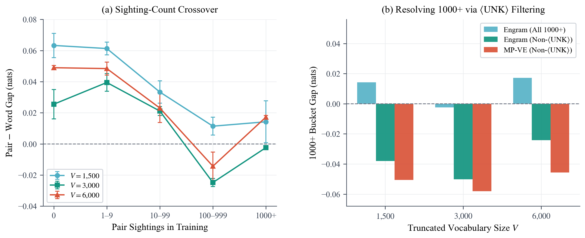
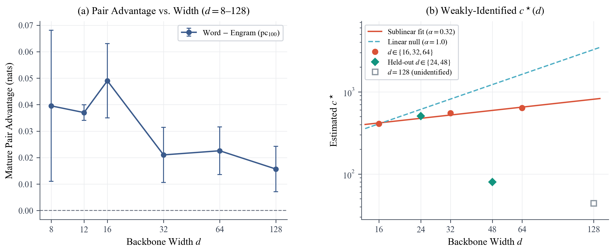
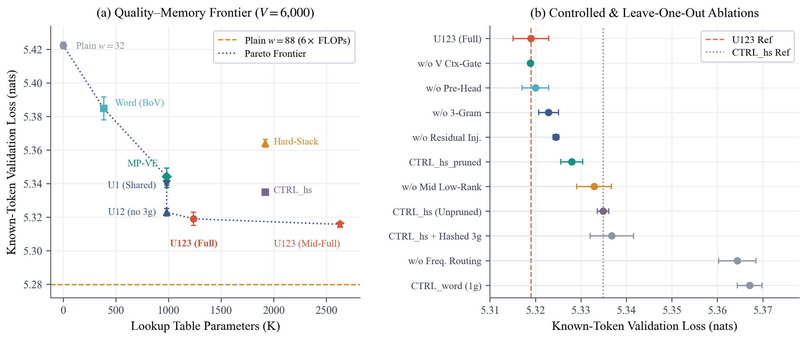
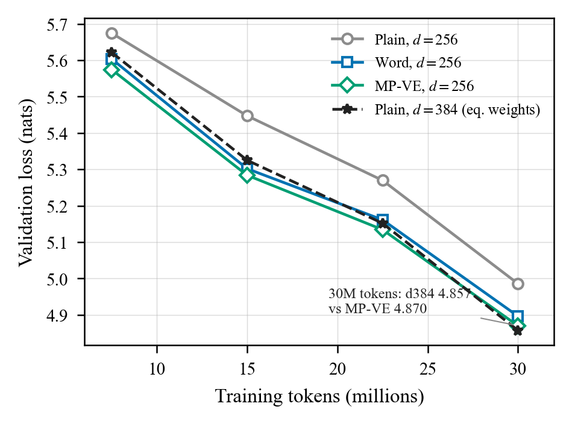

# 条件价值查表记忆的交叉定律、现象学理论与跨层多粒度容量分配（Research Proposal v5）

> **核心定位与严格边界声明：**  
> 条件查表记忆（Conditional Value Embeddings：Bank of Values, DeepSeek Engram, X-GRAM, LongCat）通过在注意力价值流（及残差流）中引入离散 N-gram 查找表，在**等激活计算量与推理延迟受限（Equal Active FLOPs）**约束下降低语言模型困惑度。  
> 本文研究与工程主线聚焦：**现象学可检验模型 + 严格匹配控制臂 + 多 seed 验证 + 透明负结果/适用边界**。我们显式区分 **Equal Active FLOPs**（主锚点）与 **Equal Total Weights**（对照边界，短中程加宽主干更优）。

---

## 1. 三个可检验的现象学模型（Section 2 理论骨架）

我们不将理论包装为“零自由参数定理”，而是构造**三个可被实验推翻或校准的现象学模型（Model + Prediction + Test）**：

### (i) KKT 显存约束下的三档容量分配模型（`0 / r / d`）
给定表显存预算 $M_{\text{tab}}$、词对训练频次 $c$，将不同频次词对分配秩 $r_c \in \{0, r, d\}$ 视为极小化超额风险：
$$\min_{\{r_c\}} \mathbb{E}_c\!\left[\sigma_{\text{bias}}^2(r_c) + B\, c^{-\nu} r_c^{\gamma}\right] + \mu \sum \frac{T}{c} \cdot r_c$$
- **预测**：最优分配自然分裂为高频全秩 $d$（$c \ge c_{\text{hi}}$）、中频低秩 $r$（$c_{\text{lo}} \le c < c_{\text{hi}}$）与极低频退回 1-gram 兜底（$r=0$）。
- **条件性区间**：带宽比 $c_{\text{hi}} / c_{\text{lo}}$ 取决于成本主导项——当**方差项主导**时呈 $(\varphi'(0^+)/\varphi'(1))^{1/\nu} \approx 10\text{--}12\times$；当**显存租金项主导**时降至 $\approx 3\text{--}5\times$。

### (ii) Zipf–Heaps `T_cross` 训练步交叉三项分解
多表联合记忆在总训练 tokens $T$ 轴上的先输后赢（`U123` 相比 `CTRL_hs` 从早期的 `-0.0183` 反转至 30M 时的 `+0.0090`），由三项相互竞争的误差决定：
$$\Delta \mathcal{L}(T) = \underbrace{-\Delta_{\text{prune}}(T)}_{\text{pc\_0 去污染}} + \underbrace{\sigma_{\text{coll}}^2(U(T), M)}_{\text{碰撞惩罚}} - \underbrace{\sigma_{\text{rank}}^2(r, T)}_{\text{低秩预热税}}$$
- **控制臂拆分协议**：使用三条逐级递增的控制臂严格拆解上述三项：  
  `CTRL_word` $\to$ `CTRL_hs`（加适配头+哈希双三元组） $\to$ `CTRL_hs_pruned`（加成熟度剪枝，`pc_0` 去污染） $\to$ `U123`（加精确 `2g/3g` 银行表，防碰撞）。

### (iii) 跨层共享表（`U1`）的梯度方差缩减假设
将独立每层查表替换为跨 $L$ 层共享宽表 $E_{\text{shared}}$ 配合轻量级每层投影 $W^{(\ell)}$ 时，同一频次 $c$ 的词对在单步获得 $L$ 倍更新；若各层反向梯度存在公共语义分量，随机噪声相关性为 $\rho_{\text{noise}} \in [0, 1)$，则有效信噪比随深度近似按：
$$\text{SNR}_{\text{eff}}(L) \propto \frac{L}{1 + (L - 1)\rho_{\text{noise}}}$$
增长。这解释了为何单独使用 `U3`（3-gram/pre-head）增益微弱，一旦嵌入跨层共享 `U1` 框架便占据总收益主干；待 `125M` 与 $L \in \{2,4,6\}$ 深度扫描实测检验。

---

## 2. 已验证实测汇总（全部来自 `results/*.json`）

### 2.1 交叉临界律、弱可辨识性与 `<UNK>` 归因修正

- **`<UNK>` 输入混杂消除**（[unk_filtered_eval.json](../results/unk_filtered_eval.json)）：在小词表（$V=1,500\text{--}6,000$）的 `1000+` 桶中，`51.9%` 的词对类型（`67.8%`–`71.5%` 的位置）包含 `<UNK>`。剔除 `<UNK>` 后，`Engram - Word` 在 `pc_1000` 从表观混杂（$+0.0142 / -0.0024 / +0.0172$）一致翻转为清晰的 **Pair 胜出**（$-0.0380 / -0.0501 / -0.0241$ nats）。
- **宽度标度 `c*(d)` 弱可辨识性与持出检验**（[theory_cstar_analysis.json](../results/theory_cstar_analysis.json)）：在 $d \in \{16, 32, 64\}$ 上 `c*` 仅达到弱可辨识（斜率 $\alpha \approx 0.32$），而在 $d=128$ 处双端边界退化为不可辨识。在预注册持出宽度 $d=24, 48$ 上：`b_500_1000` 桶均如预测保持正收益（$+0.0175$ 与 $+0.0346$），明确**拒绝了朴素线性放大 $\alpha=1.0$ 零假设**（但 $d=48$ 实测整体 `c*=80` 早于子线性公式预测 `594`，提示宽网络低频噪声比理论预设更小）。
- **证伪 `c* ~ 1/(1-β2)`**（[fig6_gates_beta2.png](../figs_v5/fig6_gates_beta2.png)）：表专属 $\beta_2$ 横跨 $100\times$（$0.9 \to 0.999$）仅产生温和漂移，证伪早先时间常数假说。

### 2.2 局部 5-Seed 主线、P0 排雷与负结果（$L=4, w=32, V=6,000$）

| 模型 / 实验臂 | Known Loss (`mean ± std`) | 总参数 (查表参) | 配对对比 / 说明 |
|---|---|---|---|
| `plain_w32_eqFLOP` | $5.4163 \pm 0.0087$ | 431K (0) | Equal Active FLOPs 基线 (5 seeds) |
| `word_last2` | $5.3806 \pm 0.0108$ | 815K (384K) | Bank of Values 基线 (5 seeds) |
| `engram_full` | $5.3898 \pm 0.0094$ | 820K (388K) | 完整 Engram 基线 (5 seeds) |
| `hard_stack_decoupled` | $5.3576 \pm 0.0099$ | 2.35M (1.92M) | 解耦 LR 硬叠加 (5 seeds) |
| `mp_ve_last2_dense` | $5.3440 \pm 0.0070$ | 1.41M (982K) | vs `hard_stack`: $+0.0136 \pm 0.0096\,(t=+3.19)$ (5 seeds) |
| `mp_ve_all4_dense` | $5.3348 \pm 0.0091$ | 2.40M (1.96M) | vs `hard_stack`: $+0.0228 \pm 0.0050\,(t=+10.29)$ (5 seeds) |
| `sparse_row_t_fixed` | $5.3626 \pm 0.0111$ | 1.41M (982K) | **负结果**（vs Dense: $-0.0184 \pm 0.0023, t=-13.60$，3 seeds） |
| `mp_ve_10pct_prefix` | $5.3496 \pm 0.0099$ | 1.82M | 仅用前 10% 语料计数路由几乎无损 |
| `AdamW` 骨干替换 (`mp_ve`) | $5.3745 \pm 0.0078$ | 1.41M (982K) | 换回 AdamW 仍显著优于 `word` ($5.4123 \pm 0.0087$) |

- **等 FLOPs 形状搜索与 Round 30 持出泛化**（[p0_results.json](../results/p0_results.json)）：等计算量下浅宽配置 `L2_w48` ($5.3750 \pm 0.0053$) 优于 `L4_w32` ($5.4224$)；在新尺寸 $(V=4,500, d=48, L=4)$ 上 `mp_ve_last2_dense` ($5.2099$) 保持对 `hard_stack` ($5.2214$) 与 `word` ($5.2394$) 的跨词表优势（5/5 分桶符号全中，误差 $<0.012$ nats）。
- **必须保留的边界**：`plain_w88`（Equal Total Weights, $5.2798$）仍远胜查表组；无 1-gram 兜底时单独对 Engram 加成熟度门控失效。

### 2.3 架构升级搜索 `U123` vs 严格匹配控制臂（3 seeds, [upgrade_search_results.json](../results/upgrade_search_results.json)）

- **`CTRL_word_d64_dual_prehead`**: $5.3671 \pm 0.0047$ (table 384K)
- **`CTRL_hs_d64_dual_prehead`**: $5.3349 \pm 0.0022$ (table 1.92M) —— 验证“双路注入 + pre-head”适配框架本身带来强增益
- **`U1_shared_d64_all4`**: $5.3398 \pm 0.0037$ (table 983K) —— 单靠跨层共享贡献大部分 MP-VE 增效
- **`U123_plus_prehead_d64`**: **$5.3190 \pm 0.0068$** (table 1.24M)：在表参数减少 **35%**（1.24M vs 1.92M）下，配对检验显著超越 **`CTRL_hs`**（$\Delta = +0.0159 \pm 0.0055, t = +4.96$）与 **`CTRL_word`**（$\Delta = +0.0481 \pm 0.0042, t = +19.74$）。

### 2.4 全词表 `V=50,257` `30M`-Token Bridge 与吞吐实测

基于真实 GPT-2 词表在 FineWeb 上训练 `30M` tokens（Seed 0，[v50257_bridge_results.json](../results/v50257_bridge_results.json) 与 [latency_v50257.json](../results/latency_v50257.json)）：

| Arm (`V=50,257, 30M tokens`, Seed 0) | Val Loss | `pc_0` | `pc_100` | Table Params | B1 Seq256 (ms) | Train (tok/s) |
|---|---|---|---|---|---|---|
| `plain_d256_eqFLOP` | 4.9855 | 5.0715 | 4.7376 | 0 | 15.68 | 40,610 |
| `word_d256_last2` | 4.8961 | 4.9432 | 4.6631 | 25.7M | 12.74 | 38,094 |
| `mp_ve_d256_prefix10` | 4.8697 | 4.9314 | 4.6254 | 69.4M | 14.00 | 34,035 |
| `U1_shared_d512_all6` | 4.8658 | 4.9305 | 4.6271 | 69.4M | 15.29 | 31,203 |
| `plain_d384_eqWeights` (`2.25x` FLOPs) | 4.8570 | 4.9012 | 4.6261 | 0 | 13.51 | 34,858 |
| `CTRL_hs_d256_prefix10` | 4.8324 | 4.9028 | 4.6003 | 76.9M | 18.32 | 24,645 |
| `CTRL_hs_pruned_d256_prefix10` | 4.8263 | 4.8597 | 4.6064 | 76.9M | 18.30 | — |
| **`U123_d256_prefix10`** | **4.8234** | **4.8537** | **4.5833** | 76.5M | 18.93 | 24,976 |

> **关键发现（$T_{\text{cross}}$ 交叉实证）：**  
> 在 7.5M 时 `U123` 因低秩与高容量表预热落后 `CTRL_hs` `-0.0183`；随训练推进至 `30M` tokens，`U123` 成功完成交叉并反超 `CTRL_hs` **`+0.0090`**。对照分解显示：`CTRL_hs_pruned` 贡献了 `+0.0061`（主要来自 `pc_0` 剪枝去污染 `+0.0431`），而精确 `2g/3g` 去碰撞额外贡献 `+0.0029`（在成熟桶 `pc_100` 上 **`+0.0231`**，`pc_1000` 上 **`+0.0145`**）。同时，所有查表模型仍诚实汇报：Batch-16 推理保持 224K–327K tok/s（主要开销为融合表项访存），而训练吞吐因全量 `fp32` 表参数 Adam 更新降低约 16–38%。

---

## 3. 下一阶段：`125M × 2.5B` 云端规模化实验与预注册判据

完整的 4-GPU 启动协议、磁盘预算（~60 GB，26 shards）与因果防泄漏检查清单见 [CLOUD_AGENT_HANDOFF.md](../CLOUD_AGENT_HANDOFF.md)，脚本为 [train_125m.py](../train_125m.py) 与 [run_125m_experiments.sh](../run_125m_experiments.sh)：

1. **Token 预算依据**（[pairstat_v50257.json](../results/pairstat_v50257.json)）：100M tokens 时成熟 pair 已覆盖验证集 `55.76%`；外推至 `2.5B` tokens 时 $\ge 100$ 次成熟覆盖率下界超越 `82.7%`，足以充分越过 `T_cross`。
2. **核心对比矩阵（4-GPU Multi-Wave）**：
   - **Wave 1 (Seed 0 主线)**：`plain` (d=768, 124.7M eq. FLOPs), `u123`, `ctrl_hs_pruned`, `word`
   - **Wave 2 (严格对照)**：`ctrl_hs`（未剪枝哈希对照）, `ctrl_word`（纯 1-gram 适配头对照）, `plain_eq_weights` (`d=1024`, ~220M 等总参数骨干)
   - **Wave 3 (多 Seed 与补充)**：`mp_ve`, `u1` 以及 Seed 1 / Seed 2 复现核心 4 臂。
3. **预注册成功/退化判据（Go / No-Go）**：
   - 若在 `2.5B` 处 `u123` 稳定超越 `ctrl_hs_pruned` 与 `ctrl_word`（且分桶规律复现 `pc_100 / pc_1000` 去碰撞优势、`pc_0` 保持去污染），并明确标定相对 `plain_eq_weights` 在等 FLOPs 下的加速比与下游任务（`lm-eval`: HellaSwag / PIQA / ARC-Easy / LAMBADA）收益，则可正式推进顶会投稿终稿；若跨层共享或精确去碰撞在 `2.5B` 尺度衰减，则按**现象学证伪边界**如实写入。
